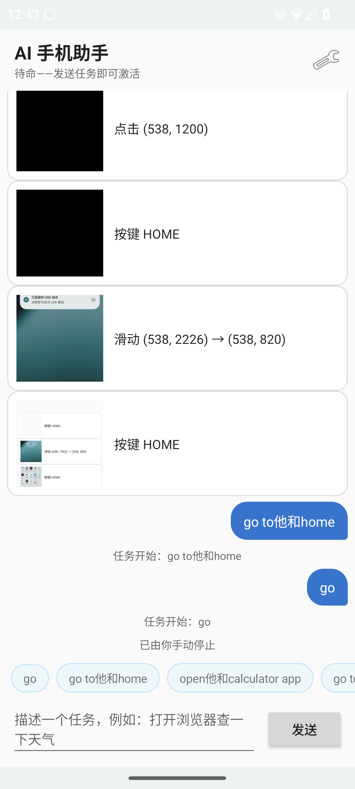
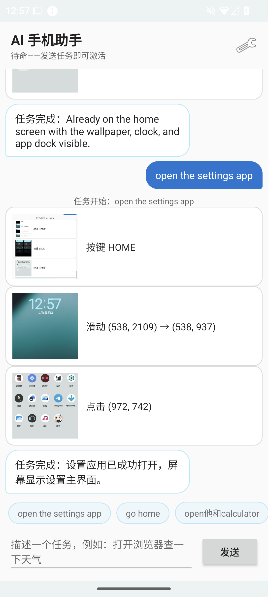
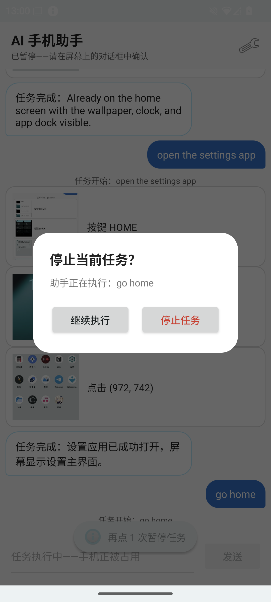

# AI Phone Assistant - System Application

A resident AI phone agent, not a sideload: a privileged, platform-signed
system app for LineageOS/AOSP that watches the screen, asks a vision-capable
LLM what to do next, and injects touch/key input. Because it ships inside the
system image it needs no accessibility service and no root hacks.

> **Status: alpha.** Built and tested on one device only — POCO F2 Pro
> (`lmi`) running LineageOS 22.2 / Android 15.

Part of the [AgentVis-OS](https://github.com/AgentVis-OS) project:

| Repo | Role |
|------|------|
| **aiphone_assistant** (this repo) | the app: capture → LLM → input loop, chat UI, settings |
| [WD40](https://github.com/AgentVis-OS/WD40) | system integration: SELinux policy, `device.mk`, priv-app packaging |

This is an add-on for LineageOS, not a standalone OS.

**It is task-driven and off by default.** The assistant only runs when you
enable it in Settings *and* set a task; otherwise nothing is captured and no
network call is made.

## How it works

```
┌──────────────────────────────────────────────────────────────┐
│                    AIPhoneAssistantService                    │
│                                                              │
│  capture loop (background thread, every N ms)                │
│      │                                                       │
│      ▼                                                       │
│  ScreenCaptureService ──► WindowManager.captureDisplay()     │
│      │                (fallback: mirror VirtualDisplay)      │
│      ▼                                                       │
│  FrameChangeDetector ── only escalate on settled,            │
│      │                    meaningful screen changes          │
│      ▼                                                       │
│  LLMClientService ──► OpenAI-compatible vision API           │
│      │                 (screenshot + user task)              │
│      ▼                                                       │
│  InputInjectionService ──► InputManager.injectInputEvent()   │
│                                                              │
│  OverlayController shows "thinking"/"acting" effects         │
└──────────────────────────────────────────────────────────────┘
```

- **Capture**: uses the platform capture API (`IWindowManager.captureDisplay`,
  requires `READ_FRAME_BUFFER`), with a mirror `VirtualDisplay` +
  `ImageReader` fallback (requires `CAPTURE_VIDEO_OUTPUT`). Works on Android
  13–15; the old `SurfaceControl.screenshot()` reflection path was removed
  from the framework in Android 12 and never worked here.
- **Gating**: a frame is only sent to the LLM when the screen settled after a
  transition and changed meaningfully vs. the last analyzed frame, with rate
  limiting and a post-action cooldown to avoid feedback loops.
- **Actions**: `tap`, `swipe`, `long_press`, `scroll`, `key_press`, `text_input`,
  `wait`, `none`. The model sees a downscaled screenshot; returned coordinates
  are rescaled to real screen pixels before injection.
- **Task**: configured in Settings. Included in every prompt; the model is
  explicitly allowed (and asked) to answer `none` when no action helps or the
  task is done.

## Screenshots

| Chat / tasks | Executing | Interrupt (3 taps on the top bar) |
|---|---|---|
|  |  |  |

More in [`demo_screens/`](demo_screens/).

## Setup (first run)

1. Flash a build containing the app (see Build below), then open
   **"AI Assistant Settings"** from the launcher.
2. Set **LLM Endpoint** — any OpenAI-compatible `/v1/chat/completions` URL:
   - OpenAI: `https://api.openai.com/v1/chat/completions` (model `gpt-4o`)
   - Zhipu: `https://open.bigmodel.cn/api/paas/v4/chat/completions` (model `glm-4v-plus`)
   - Local: `http://192.168.1.100:11434/v1/chat/completions` (Ollama, vLLM, ...)
3. Set **Model** and **API Key** (leave the key empty for local servers).
   Builds that include the optional on-device backend can set **Backend** to
   *On-device* to run Gemma 4 on the phone instead — see
   [On-device model](#on-device-model-gemma-4-e2b-via-litert-lm).
4. Tap **Test Connection** — it sends a text-only ping and toasts the result.
5. Set a **Task**, e.g. *“打开设置并调高亮度”* or *"open the browser and search
   for the weather"*.
6. Flip **Enable AI Assistant**. A foreground-service notification appears;
   the assistant now acts whenever the screen changes meaningfully.

Everything is stored in the app's `SharedPreferences`
(`/data/user/0/com.android.aiphoneassistant/shared_prefs/ai_phone_assistant.xml`
when running as system uid) and is re-read on every request, so you can change
the task or endpoint while it runs. Clearing the task makes the assistant idle.

## On-device model (Gemma 4 E2B via LiteRT-LM)

Optional, **off by default**. With **Backend = On-device**, the same prompt and
screenshot are run locally by
[LiteRT-LM](https://github.com/google-ai-edge/LiteRT-LM) 0.18.0, so no network
is needed. Builds without it are remote-only: no Backend rows in Settings, and
none of the runtime (~22 MB `.so` plus Kotlin jars) in the APK.

Enable it at build time:

- Standalone: `WITH_LITERTLM=1 tools/build-apk.sh`. CI publishes this variant
  as `AIPhoneAssistant-litertlm.apk`.
- Tree build: `WITH_LITERTLM=1 bash build.sh ...`. The product makefile (e.g.
  `device.mk`) must also set
  `$(call soong_config_set,aiphoneassistant,with_litertlm,true)`.

The backend code lives in `src-litertlm/`. `tools/fetch-litertlm.sh` downloads
the pinned runtime into `libs/` (gitignored).

The model is not in the APK. Download
[`gemma-4-E2B-it.litertlm`](https://huggingface.co/litert-community/gemma-4-E2B-it-litert-lm)
(~2.6 GB, Apache-2.0, not gated) and copy it into the app's private storage.
`adb root` is required:

```bash
adb push gemma-4-E2B-it.litertlm /data/local/tmp/
adb shell 'd=/data/user/0/com.android.aiphoneassistant/files/models; mkdir -p $d && \
  mv /data/local/tmp/gemma-4-E2B-it.litertlm $d/ && chown -R system:system $d && restorecon -R $d'
```

That path is the default **On-device Model File**; change it in Settings to use
another `.litertlm`. **On-device Accelerator** = GPU (OpenCL) falls back to CPU
if the GPU backend fails to load. The model is loaded on the first request
(seconds), kept resident while the service runs, and unloaded when it stops.
Expect roughly 5–7 tok/s decode and tens of seconds per round on a
Snapdragon 865, and up to ~3.6 GB RAM peak on image turns.

## LLM response format

The model must answer with a single JSON object:

```json
{"action": "tap", "x": 540, "y": 1200}
{"action": "swipe", "x": 540, "y": 1600, "endX": 540, "endY": 400, "durationMs": 300}
{"action": "long_press", "x": 540, "y": 1200, "durationMs": 800}
{"action": "scroll", "x": 540, "y": 1200, "deltaY": -400}
{"action": "key_press", "key": "BACK"}
{"action": "text_input", "text": "hello world"}
{"action": "wait", "durationMs": 1000}
{"action": "none"}
```

- Coordinates are in the pixel space of the image the model received (stated
  in the prompt) and are rescaled to screen coordinates automatically.
- Key names: `BACK`, `HOME`, `APP_SWITCH`, `ENTER`, `DEL`, `SPACE`, `TAB`,
  `DPAD_UP/DOWN/LEFT/RIGHT`, `VOLUME_UP/DOWN/MUTE`, `POWER`, ...
- Malformed answers or actions with missing coordinates are ignored — the
  app never guesses a default tap position.

## Required permissions (signature-level)

| Permission | Purpose |
|------------|---------|
| `android.permission.READ_FRAME_BUFFER` | `WindowManager.captureDisplay()` |
| `android.permission.CAPTURE_VIDEO_OUTPUT` | mirror `VirtualDisplay` fallback |
| `android.permission.CAPTURE_SECURE_VIDEO_OUTPUT` | not used by default (secure layers stay black) |
| `android.permission.INJECT_EVENTS` | `InputManager.injectInputEvent()` |

Granted via `privapp-permissions-aiphoneassistant.xml`; the app must be
platform-signed (`certificate: "platform"` in Android.bp) and installed in
`/system/system_ext/priv-app/`.

## Build

Three ways, from least to most involved. All paths below are relative to this
repo; `$TREE` is your LineageOS source tree.

### 1. Standalone APK (no AOSP tree)

```bash
tools/build-apk.sh        # -> out/AIPhoneAssistant.apk (+ .sha256)
```

Needs only JDK 17+ and Android SDK build-tools ≥ 35 (`ANDROID_HOME` or
`BUILD_TOOLS=/path/to/build-tools/35.x`). The script downloads a pinned
hidden-API framework jar and the public AOSP *test* platform key
(sha256-verified), then runs aapt2 → javac → d8 → zipalign → apksigner. CI
runs the same script on every push/PR and attaches the APK to GitHub
Releases on `v*` tags.

Limits to know about:

- The APK is signed with the **public AOSP test platform key**. It installs
  (`adb install -r`) only over builds signed with that key — the default for
  self-built LineageOS, **not** official LineageOS builds.
- An APK alone is not a working install. The first install needs the
  privileged-app setup — `/system_ext/priv-app/` placement,
  `privapp-permissions-aiphoneassistant.xml` and the SELinux policy
  (`sepolicy/`) — which comes from [WD40](https://github.com/AgentVis-OS/WD40).
  Releases include these files as `aiphoneassistant-integration.tar.gz`.

### 2. Incremental repack on an existing build

For development once a tree has been built once, see [AGENTS.md](AGENTS.md)
(~2 minutes, `adb install -r`).

### 3. Full image build

```bash
bash build.sh "$TREE" lineage_lmi-ap3a-userdebug
```

Syncs the sources into `$TREE/packages/apps/AIPhoneAssistant` and builds with
the tree's toolchain; details in [BUILD_INTEGRATION.md](BUILD_INTEGRATION.md).
SELinux rules cannot be pushed at runtime — after changing
`sepolicy/*/aiphoneassistant.te` do a full image build and flash.

## Known limitations

- **text_input types keyboard events**: it works for ASCII/Latin text where a
  text field is focused. Chinese/emoji input would need an IME-level
  integration and is not supported.
- **Secure (FLAG_SECURE) screens capture as black** by design — banking apps,
  DRM video etc. appear black to the model. To include them, set
  `setCaptureSecureLayers(true)` in `ScreenCaptureService.captureFrame()`
  (the app already holds `CAPTURE_SECURE_VIDEO_OUTPUT`), but be aware the
  content is then sent to your LLM endpoint.
- **One action per analysis round**; complex flows take several
  capture→analyze→act cycles (typically a few seconds each).
- The overlay ("thinking" tint + "acting" ripple) needs
  `SYSTEM_ALERT_WINDOW`, which preinstalled apps get automatically.

## Security considerations

⚠️ **This app has full device control**: it can read everything on screen and
inject any input, as the system uid. Treat it as a powerful automation agent:

- Run it only on a device you control, ideally a test device.
- Prefer a **LAN or self-hosted LLM endpoint** — every analyzed screenshot is
  sent to the configured endpoint (JPEG, ≤1024px).
- The API key sits in plain-text SharedPreferences (system-uid readable).
- It is disabled by default and only starts on boot if you enabled it.

## Troubleshooting

```bash
# Follow what the assistant is doing
adb logcat -s AIPhoneAssistant AIPhoneAssistant.ScreenCap AIPhoneAssistant.Input \
               AIPhoneAssistant.LLM AIPhoneAssistant.Boot

# Check the signature/priv permissions actually got granted
adb shell dumpsys package com.android.aiphoneassistant | grep -E "READ_FRAME_BUFFER|INJECT_EVENTS|CAPTURE_VIDEO"

# SELinux denials (capture/input silently failing on enforcing builds)
adb shell dmesg | grep avc | grep system_app
# then generate rules with audit2allow as described in SEPOLICY.md
```

- **Captures return null** → check `READ_FRAME_BUFFER` grant and SELinux.
- **No LLM calls** → endpoint or task not set (the loop idles until both are
  configured); check for `LLM analysis error` in logcat.
- **Taps land in the wrong place** → make sure your model returns coordinates
  in image pixel space; if a model ignores the stated image size, try a
  stronger vision model.

## License

Copyright (C) 2024 The LineageOS Project

Licensed under the Apache License, Version 2.0 (the "License");
you may not use this file except in compliance with the License.
You may obtain a copy of the License at

     http://www.apache.org/licenses/LICENSE-2.0

Unless required by applicable law or agreed to in writing, software
distributed under the License is distributed on an "AS IS" BASIS,
WITHOUT WARRANTIES OR CONDITIONS OF ANY KIND, either express or implied.
See the License for the specific language governing permissions and
limitations under the License. The full license text is in the
[LICENSE](LICENSE) file.
